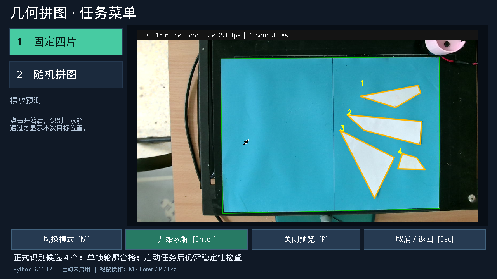

# 固定四片颜色适配与识别稳定性修正

已部署 `/opt/ec26e/releases/vision-auto-20261023`。保持新候选 PL、机械标定、运动权限、旋转 20 RPM 和 XY 档位 80；仅更新应用与固定模式颜色配置。全程只识别和求解，没有执行搬运。

## 故障原因

用户本次任务在采图阶段约 29.62 秒重试 150 帧后手动取消，尚未进入求解。每帧均因“蓝底采样不足”退出，所以没有轮廓，也不会累积稳定审查窗口。

部署的 `320/218` 分割参数要求蓝通道大于红/绿最大值的 1.25 倍，并按背景亮度过滤。当天偏青底板在此条件下只有 **0%** 的采样被视为蓝底；`275` 条件下约 **89.3%**。只降颜色比例、保留亮度过滤又会把阴影并入边界，令三角片产生约 4.94 mm 的伪短边，被完整几何检查拒绝。

昨天录制的偏蓝光照则相反：`275/0` 会吞掉带蓝色偏色的纸片，`320/218` 能识别四片。因此不能只永久改成另一个静态阈值。此前速度/焦点配置脚本也写入全局颜色参数，扩大了配置影响范围；现已分离职责。

## 改动

- 固定模式支持独立 `TASK1_BLUE_*`，随机模式沿用 `TASK2_BLUE_*`。旧全局参数仍作为兼容默认值。
- 固定模式启用 `TASK1_BLUE_PROFILE=fixed_auto`：逐帧稀疏采样，蓝底证据充足时使用已验证的 `320/218`，否则验证 `275/0` 所需的背景证据。两条路径都要求至少 40% 采样支持蓝底；证据不足明确拒绝，不沿用过期阈值。配置选择不依赖期望片数或求解是否成功。
- PS 只计算少量采样统计，颜色分割、滤波、形态学仍在现有 PL 执行。CPU、Linux PL 和 PYNQ 使用同一组本帧参数，不需要重新构建或加载硬件。
- 保留至少两秒、六张不同新帧的稳定审查、原几何门槛及完整执行检查。错误提示加入实际蓝底比例与颜色阈值，任务预览显示具体失败原因。
- `configure_capture_release.py` 默认只设置焦点/速度，不再覆盖颜色；`--fixed-vision` 独立备份并更新固定模式配置。菜单验收脚本增加 `--mode fixed`，可以直接覆盖本次故障入口。

## 验证结果

- 主机相关测试 59 项、3 子测试通过，覆盖新旧实拍、多档曝光、无蓝底、两种模式配置隔离，以及 PL 在连续帧中同步切换颜色和亮度寄存器。另一个未改动的历史测试要求默认 `short_edge_merge_mm=20`，仓库原配置实际为 12；首次运行复现失败，针对本次变化的回归排除该历史断言，未改断言或默认值掩盖问题。
- 当前相机连续 30 帧全部识别四片，CPU/PL 掩膜与轮廓相同。
- 自动配置在昨日 12 帧和今日 2 帧原图回放中全部识别四片；两种颜色状态分别选择对应参数，CPU/PL 掩膜逐像素一致、几何逐项一致。
- 通过实际 Tk 菜单连续三次固定模式只求解，均显示四片轮廓和本次预测摆放图。每次稳定审查处理 6 张新帧、无无效帧；从点击到完整方案分别 **5.892 / 5.900 / 5.742 秒**，任务内部时间 **4.960 / 4.879 / 4.822 秒**。三次不代表 30 次 P95 或机械验收。
- 预览约 16.6～17.2 FPS，分析约 1.9～2.1 FPS，预热后相机首帧约 0.69 秒。此次主要恢复有效识别，没有宣称分析帧率提高。
- 安装核验 92 个应用文件与 wheel 一致，配置只新增三个 `TASK1_BLUE_*` 项，菜单/任务 JSON、机械参数、运动权限、boot ID 和 bitstream 均保持不变。生产菜单已恢复空闲。

证据：[原图诊断](blue-20261023/diagnostic.json)、[30 帧当前场景](blue-20261023/live-30.json)、[跨颜色回放](blue-20261023/auto-replay.json)、[三次真实菜单只求解](blue-20261023/live-solve.json)、[部署核验](blue-20261023/installed.json)。

## 范围与回滚

自动配置本轮仅用于固定白纸四片。随机扑克牌配置保持原值，原扑克花纹单元回归通过；尚未据此宣布随机模式在当前偏青光照下通过实物验收。未知底色、严重遮挡及不同材质仍需验证，不能以此次有限实拍覆盖所有光照。

软件备份在发布目录 `production-before/`，本次自动配置前的环境文件为 `machine-before-vision.env`。使用同目录 `configure_capture_release.py --release /opt/ec26e/releases/vision-auto-20261023 --fixed-vision --rollback` 可恢复该配置快照；它校验当前文件哈希，拒绝覆盖后续人工修改。随后可用同目录 `install_robust_release.py --release /opt/ec26e/releases/vision-auto-20261023 --apply --rollback` 回滚软件。该快照为同日已验证的固定静态配置版本；原故障版本保存在更早的 `vision-20261023/production-before/`，不建议恢复原故障颜色参数。
