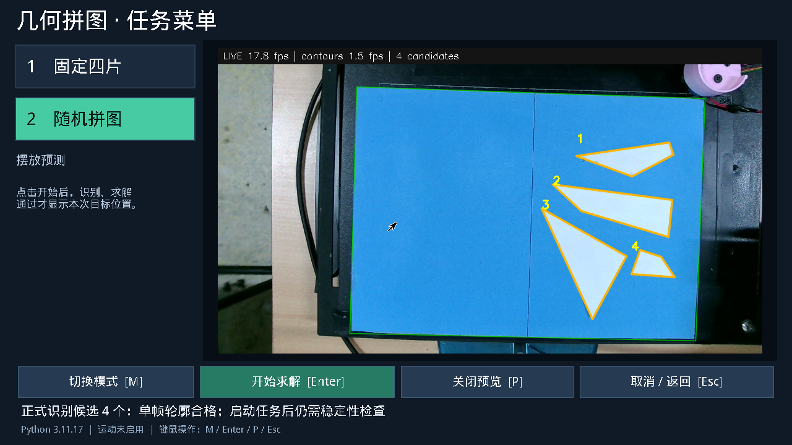

# 相机启动、轮廓稳定与电机速度调整

已部署 `/opt/ec26e/releases/capture-20261022`。只重启菜单服务，未重启板卡、修改 PL 或自动执行搬运。应用主机测试 **124 项、32 子测试通过**；核验了板端 326 个软件文件、配置变更、菜单自启、鼠标光标和屏幕常亮。

## 问题与修改

- 预览启动原先每次加载约 2.5 秒 Python 依赖，再创建 OpenCV Lab 查找表。现在菜单空闲时预热软件，收到预览请求后才打开相机、PL 和任务锁。
- 每帧 A4 精定位只计算四条边附近的原分辨率 Lab/色差；保留 5×5 模糊的完整邻域。新边超出计算范围即回到完整搜索，所有几何、外观、遮挡检查保持不变。
- 随机模式的浅角恢复先比较简化后的顶点数，仅对可能新增顶点的轮廓做直线拟合。没有省略凹角或 T 结点规则。
- 显示精修多边形，按位置及循环顶点顺序匹配，小于 3 个原图像素的变化才平滑。大位移、片数、顶点数、无效检测均立即重置。轻微整体亮度变化不再反复隐藏轮廓；局部移动和超过 2 秒的结果仍撤掉。平滑坐标不进入求解或运动。
- UVC 固定焦点为 68；必须先单独关闭自动对焦，再单独写焦点。将两个控制合并发送会被该驱动拒绝。继续使用 1280×720 MJPEG、30 FPS 采集，显示与分析分别刷新，图像运算使用两个线程。
- 固定四片旧颜色参数 `ratio=275, background_fraction=0` 会将当前带蓝色偏色的白纸片吞入背景。12 张录制图全部只留下一个候选，实时稳定采图因此超时。改为已验证的 `320/218` 后，同一 12 张均检测到四片；固定/随机现在使用相同分割参数，片数及模板规则仍各自校验。

## 板端结果

| 指标 | 修改前 | 修改后 |
| --- | ---: | ---: |
| 请求预览到首帧 | 3.28 s | 0.78 s |
| 请求预览到首个有效轮廓 | 5.88 s | 1.77 s |
| 预览助手显示 / 分析 | 15.0 / 1.25 FPS | 19.2 / 1.91 FPS |
| 完整 Tk 菜单显示 / 分析 | — | 17.8 / 1.54 FPS |
| 录制回放 A4 定位中位数 | 238.9 ms | 158.8 ms |
| 录制回放轮廓精修中位数 | 168.7 ms | 144.5 ms |
| 静止场景相邻帧顶点平均位移 | 0.496 px | 显示平滑后 0.200 px |

修改后的首帧时间以菜单已完成空闲预热为前提；软件预热本身约 3.8 秒。预览助手和完整 GUI 是不同负载，不能混算帧率。轮廓结果年龄中位数由 1.015 秒变为 0.956 秒，仍非逐视频帧检测，不能宣称零延迟。

同一 12 张图的优化前后工作区角点、碎片顶点差异均为 **0 px**。这是计算路径等价性，不是机械精度验收。新分割配置在三张原始图上的 CPU/PL 掩膜逐像素相同。正式任务仍要求至少两秒、六张不同新帧，不使用显示滤波替代稳定审查。

安装后连续三次真实相机固定四片只求解全部成功：**4.87 / 4.81 / 4.94 秒**，包含相机开启、稳定识别和完整方案生成；先前候选验证另一次为 4.77 秒。三次不能替代 30 次 P95 和不同摆放验收。当前 M0 状态 `fault=0, armed=false, magnet=false`。

USB3 YUYV 对照反而增加 CPU：FFmpeg 平均占用约 1.58 核，MJPEG 约 1.14 核；并行识别中位数约 486 / 390 ms，因此保留 MJPEG。另测 OpenCV 直接取帧约占用 0.71 核，但尚未完成进程超时与取帧语义验证，没有替换生产采集器。

[计时与显示滤波数据](capture-20261022/summary.json) · [安装核验](capture-20261022/installed.json) · [颜色参数回放](capture-20261022/fixed-color-check.json) · [CPU/PL 掩膜](capture-20261022/mask-equivalence.json) · [发布哈希](capture-20261022/manifest.json)



## 运动设置

| 参数 | 原值 | 现值 |
| --- | ---: | ---: |
| XY 实际指令速度档位 | 写死 64 | `MOTION_XY_SPEED_LEVEL=80` |
| XY 距离等待估算 | 80 mm/s | 100 mm/s |
| 旋转轴 | 15 RPM | **20 RPM** |

新增可配置 XY 档位，底层报文、理论完成时间、超时均使用同一值。原参数 `MOTION_XY_SPEED_MM_PER_SECOND` 只控制外层等待，不能单独改变实际电机速度。仿真执行测试确认修改档位只改变 XY 速度和校验和，方向、脉冲数、Z 指令不变。

标定、软件限位、Z 速度 64、Z 等待 1 秒、XY 固定余量 1 秒、磁铁吸放等待 0.3 秒、旋转反馈和运动顺序保持原值。实际加速后是否失步、打滑、吸取稳定，留给用户手动搬运验收，未以软件测试替代。

## PL 求解评估

本轮没有增加或重载 PL 核。一次正常录制随机案例纯求解 6.70 秒，其中 446 次 PL 配准、47 次硬件批次，传输累计 62.6 ms、核等待累计 8.25 ms、CPU 数值回退 0；包含打包和结果处理的随机配准路径约 0.20 秒。因此，仅加速现有配准核无法将完整求解从秒级降到毫秒级。

下一项值得原型验证的是固定模板候选的批量评分，以及随机候选的批量边界/相交/距离粗筛。随机分支枚举、凹多边形拓扑和最终有效性仍需要完整 PS 检查；不能把四凸片间隙核直接用于随机凹片。新核需单独完成 CPU 对照、HLS 仿真/综合、Vivado 实现/时序、bit/HWH 配套及板端传输收益验证，当前没有这些新核的完成结论。

`cProfile` 的大量函数探针会触发现有搜索墙钟预算，使正常 6.7 秒案例进入恢复分支并最终拒绝执行；该约 31 秒记录只作热点定位，不作正常性能或成功率样本。原始日志均保留于板端 `/opt/ec26e/validation/capture-20261022/`。正式计时不启用这些探针。

## 复现与回滚

`deploy/axu5ev/validate_capture_release.py` 在任务锁内回放原始图；`benchmark_preview.py` 测首帧/首个轮廓/帧率，不创建执行器。`configure_capture_release.py` 保存配置原文、验证固定/随机配置后才应用，并记录前后哈希；不会覆盖后续人工改动。

仅恢复本轮速度、焦点与颜色设置：

```sh
. /opt/ec26e/env.sh
export EC_PL_BITSTREAM=/opt/ec26e/staging/20261020/axu5ev-reset-bundle/puzzle5ev.bit
python /opt/ec26e/releases/capture-20261022/configure_capture_release.py \
  --release /opt/ec26e/releases/capture-20261022 --rollback
```

随后如需恢复旧软件，再执行该目录的 `install_robust_release.py --release /opt/ec26e/releases/capture-20261022 --apply --rollback`。旧软件不认识新的速度档位，软件和速度配置应一并回滚。恢复焦点配置后，若要立即恢复相机自动对焦，可在预览关闭时执行 `v4l2-ctl -d /dev/ec26e-camera --set-ctrl=focus_auto=1`。
