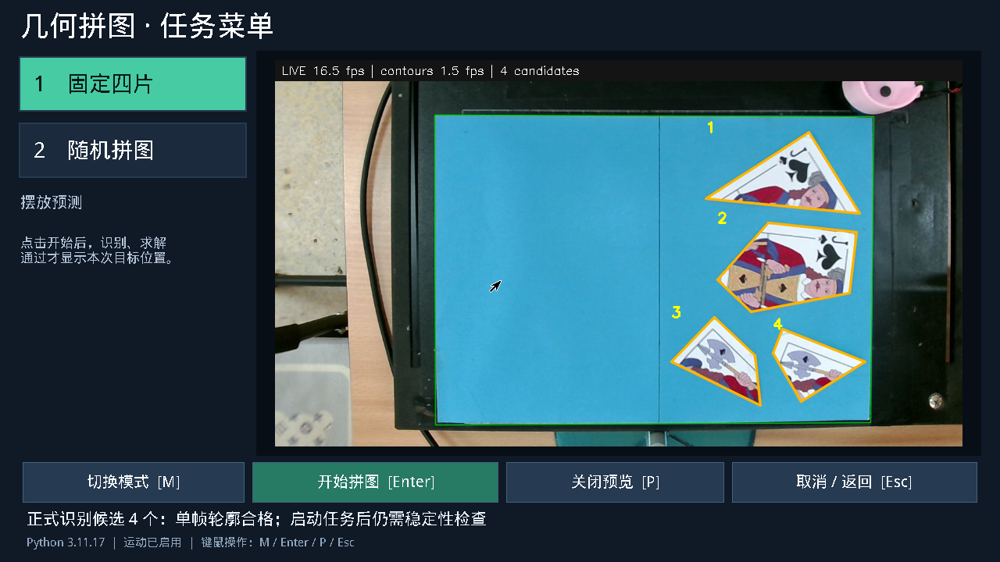

# 扑克牌切口花纹与中间蓝底颜色适配

## 原因与修改

通过 A7A 网关获取原始画面，当前四片扑克包含蓝灰、黑、红、黄图案，部分蓝灰图案直接接触切口。工作区能正常定位；原参数连续 16 帧未通过，一帧多出第五个连通域，其余均无效多边形。

原 `fixed_auto` 在 275/0 和 320/218 两档分割参数间切换，缺少中间色温；当前底板稀疏样本的蓝色比值低十分位约 319.6，中位约 327.2，硬切到 320 会碎裂背景，退到 275 又会吞掉边缘上的蓝灰牌面。因此单纯补内部孔洞或增大形态学核不能解决切口破损，也可能破坏真实凹角。

`resolve_blue_parameters()` 现在先要求至少 40% 稀疏采样支持蓝底，再以背景通道比例低十分位的 94% 在 275～320 间估计整数颜色阈值；中间值配合背景亮度中位数的 200/256 设置亮度下限。275 保留低亮度路径，320 保留原 218/256。当前单帧得到约 300/111；参数逐帧更新，不以片数、模板或求解成功选择。新 `background_auto` 为两种模式统一入口，旧 `fixed_auto` 名称兼容该逻辑。

PS 只做稀疏估参，PL 继续完成全幅分割、滤波和形态学。CPU/PL 共用同一整数参数。未改轮廓/顶点精度、凹角保留、片数规则、几何有效性或连续稳定审查。缺少蓝底证据继续明确报错，不复用上帧阈值。

## 验证

- 新实拍 fixture `sw/tests/fixtures/vision/poker-j-mid-blue.png`；0.6/0.8/1.0/1.1/1.2 倍曝光，固定与随机检测均得四片，顶点数为 3/5/4/4，曝光回放与参考顶点差小于 2 mm。
- 原青底、蓝色偏光、扑克牌样本、真实凹角、无蓝底拒绝及 Linux PL 寄存器更新回归通过。
- 录制 16 帧：两种模式均 16/16 识别；真实相机另采固定 16 帧与随机 16 帧，均 16/16 合格。相对各序列首帧最大顶点偏差：回放 1.111 mm，固定实时 0.996 mm、随机实时 0.687 mm。单场景统计不能替代广泛鲁棒性验收。
- 同一 16 帧 CPU/PL 掩膜逐像素完全一致。
- 随机真实稳定审查和 CPU 求解通过，置信度 0.99。安装后的全 PL 路径另一次通过：6 张新帧、无无效帧，任务内部约 8.233 秒，求解约 4.146 秒；实际刚体配准 722 项/57 批、候选距离 570 项/9 批，CPU 数值回退为零。非 30 次 P95。
- 当前扑克是 3/5/4/4 边组合，不匹配原固定四片模板；固定识别通过后仍正确拒绝“没有可用的固定模板候选”。用户应选择随机模式处理这组实物。

在 `sw/` 运行：

```powershell
poetry run pytest tests/unit/test_capture_settings.py tests/unit/test_task2_config.py tests/unit/vision/test_adaptive_preprocess.py tests/unit/vision/test_linux_pl.py tests/unit/test_production_preview.py tests/unit/test_preview_tracking.py tests/unit/tasks/test_task1_runner.py -q
poetry build -f wheel
```

68 项测试通过。顺带修正已有 Task2 配置测试中两条过时断言：仓库原配置的合并短边/最短边已为 12 mm，测试仍要求 20 mm；仅修正断言与现有配置一致，没有改变本轮运行门槛。随机求解器的竞赛约束另行检查。

## 部署与证据

发布目录 `/opt/ec26e/releases/cards-color-20261026`。持任务锁、菜单空闲时备份软件并安装，再独立备份配置，仅把 `TASK1_BLUE_PROFILE` 和 `TASK2_BLUE_PROFILE` 设为 `background_auto`。固定/随机完整配置对象对比确认其他值不变，安装 92 个 Python 源文件与 wheel 一致。X/Y 127、旋转 50 RPM、Z 80，机械标定、并行回程、Z 收尾下降、运动权限、自启和光标保留。PL、M0 固件未改。

证据：[原版16帧](cards-color-20261026/baseline.json)、[候选回放与新帧摘要](cards-color-20261026/candidate-validation.json)、[全PL性能](cards-color-20261026/full-pl-performance.json)、[安装核对](cards-color-20261026/installed.json)、[配置差异](cards-color-20261026/settings.json)、[发布清单](cards-color-20261026/manifest.json)、[正式菜单预览](cards-color-20261026/preview.json)。完整原图与详细顶点记录保留在板端 `/opt/ec26e/validation/cards-20261026/`，本机生成目录 `build/axu5ev/cards-20261026-frames.zip`。



本轮自动验证未执行运动。相机与工作区仍依赖原机械坐标关系；若要自由移动相机，需要另行接入固定位置的 ArUco 等标记进行自动平面定位，本轮未添加标记定位。底板相对机构移动仍需建立新的机械对应关系。

## 回滚

菜单空闲时，加载板端 Python 环境与当前 `EC_PL_BITSTREAM`，先恢复旧配置，再恢复软件：

```sh
python /opt/ec26e/releases/cards-color-20261026/configure_capture_release.py --release /opt/ec26e/releases/cards-color-20261026 --background-auto --rollback
python /opt/ec26e/releases/cards-color-20261026/install_robust_release.py --release /opt/ec26e/releases/cards-color-20261026 --apply --rollback
```

备份为该目录 `machine-before-background.env` 与 `production-before/`；后续配置若已改动，工具拒绝覆盖。
