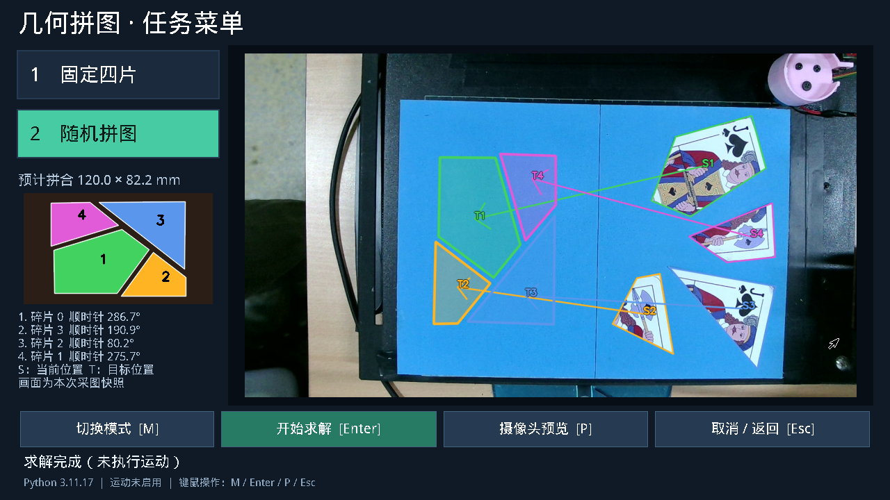

# 2026-10-22 鲁棒性、菜单与传输优化

平台：AXU5EV-P / XCZU5EV，CPython 3.11.17。A7A 重装后已恢复 Wi-Fi → 共享以太网 → FPGA 的 SSH/SFTP 链路。板端时钟仍为 10 月 20 日，本文日期使用开发电脑日期。

独立求解器源码提交：`323c4e3`。主工程和求解器分别提交；运行包以随附 wheel SHA-256 和发布号对应，不依赖邻接源码目录。

本轮自动测试只识别、求解和检查显示，不发送电机或电磁铁指令。沿用机械标定、转轴策略、动作顺序和等待时间。硬件复用原 bit/HWH，无重启、无 PL 重载、无新 RTL/HLS 构建。

## 实现

1. 随机整边链快速搜索支持混合 3～5 边；先把候选交给完整验证，失败才展开 T 形/部分边匹配。向量化最小包围矩形并缓存组件排序特征，减少 GEOS 重复工作。
2. 优化器直接约束赛题宽高，避免 120.003 mm 这样的边界结果造成无谓深搜。恢复候选优先选择全部通过检查的解，修复评分稍好的诊断候选压过合格解的问题。门槛没有放宽。
3. DMA 像素打包由 NumPy 非连续字节写改为 OpenCV 直接写连续缓冲区。有效 B/G/R 字节完全一致，未被 HLS 使用的高字节从 0 改为 255；协议和硬件不变。
4. 实时显示与轮廓分析分开，队列只保留最新帧；预览显示使用 880×495，正式识别仍处理原始 1280×720。画面变化或结果过期时隐藏旧轮廓。Tk 复用图像对象，切换任务时异步释放相机。
5. 新增稳定采图快照上的预测落点、方向、顺序及最终拼合图。坐标反变换使用本次透视矩阵和正式 MovePlan，失败/新任务不会沿用旧预测。
6. 鼠标箭头、按钮手形、点击状态和取消逻辑已适配；Xorg 休眠计时置零，Tk 连接建立后再关闭屏保/DPMS，避免首个窗口连接前的 Xorg 重置和十分钟后黑屏。相机通信和结果投影拆为独立模块，旧板测试归档，见 [代码结构](../architecture.md)。

## 验证口径

- 新增/受影响测试：应用 52 项通过；求解器 50 项、9 子测试通过。包含坐标投影、过期轮廓、取消待启动任务、结果缓存上限、DMA 字节、混合边数、数值边界、候选优先级、批次上限及错误传播。
- 向量化包围矩形在 200 个随机平移凸包上与 GEOS 最小矩形面积一致（容差 1e-8）。
- 完整主机扫描仍有历史和平台差异项，不能宣称全套通过：Windows 缺 Linux flock/符号链接权限/设备路径，外部 NPU 不在默认环境；旧配置/固定模板断言与当前实物配置不符。求解器固定宽度和间隙的两个失败已在修改前 HEAD `c2ed72d` 的隔离源码中复现，实际机械输出未为通过旧断言而改动。
- 板端预处理在不同尺寸、交替尺寸和真实扑克牌图像上共 10 次逐像素 CPU/PL 对照，差异均为 0；129 次刚体配准分 4 批，最大角误差 0.0000214°、平移误差 0.0000153 mm、CPU 回退 0；401 点间隙扫描最大误差 0.00000322 mm。
- 30 次 1280×720 DMA 打包：旧 NumPy 中位数 26.385 ms，新直接写 0.781 ms；这是打包阶段，不代表整个识别流程的倍数。
- 30 组已录制扑克牌几何：PL 30/30 成功，中位数 6.90 s、P95 7.50 s；CPU 30/30 成功，中位数 6.98 s、P95 7.55 s。PL 实际请求 14,383 次、1,494 批、数值 CPU 回退 0，传输累计 2.00 s。这批配准负载的总收益很小，主要提速来自搜索修正。计时不含重新采图/稳定审查。
- 固定四片和随机 2/3/4 片各追加 3 组板端几何回归，12/12 成功；两个实际慢解边界案例分别为 7.84 s、6.70 s，全部通过完整检查。
- 最终预览 14.62 FPS、轮廓分析 1.37 FPS，鼠标图像含 118 个可见像素。显示新帧和分析不同步，正式任务仍使用六张新帧稳定检查。
- 同一扑克牌摆放，修正前实时菜单端到端一次 38.13 s，修正后分别 14.21 s、14.42 s；最终一次处理 6 帧、无无效帧，求解 7.89 s。另连续 3 次从预热任务派发到完整方案为 13.37 / 14.01 / 13.67 s，全部成功，包含采图与稳定判断。不同新帧不当作严格同输入加速比，3 次也不能替代 30 次 P95 验收。

完整原始记录位于板端 `/opt/ec26e/validation/robust-20261022/`，主机临时数据位于 `build/axu5ev/robust-20261022/`。仓库仅保存汇总、硬件核验、安装清单和代表性画面。

[逐次计时与 PL 工作量](robust-20261022/summary.json) · [硬件一致性](robust-20261022/accelerators.json) · [部署核验](robust-20261022/installed.json) · [发布哈希](robust-20261022/manifest.json)



## 发布与回滚

发布目录：`/opt/ec26e/releases/robust-20261022-v2`。安装器先核验 wheel 和已加载硬件，再持全局任务锁创建不可覆盖的回滚快照；更新应用、求解器、Shapely 2.1.2 / GEOS 3.13.1、菜单启动脚本和 Xorg 显示配置。机器配置文件保持逐字节不变。

部署后已逐文件核验 324 个安装文件、全量配置哈希、原 bit 状态及 boot ID、自启链接、菜单预热和光标；`pip check` 通过。菜单处于空闲，运动权限仍为开启，未自动执行运动。v1 留存本轮更新之前的完整软件快照；以下命令直接退回 10 月 21 日版本：

```sh
. /opt/ec26e/env.sh
unset PYTHONPATH
export EC_PL_BITSTREAM=/opt/ec26e/staging/20261020/axu5ev-reset-bundle/puzzle5ev.bit
python /opt/ec26e/releases/robust-20261022-v1/install_robust_release.py \
  --release /opt/ec26e/releases/robust-20261022-v1 --apply --rollback
```

回滚恢复旧软件包、原生 Shapely 库和两个显示配置文件，保留用户后续修改的机械配置。服务重启只回到菜单，不自动启动任务。

硬件 SHA-256：

- bit：`07beeb20ef4fcb39662f90a49fb97603a40d592e57c66aa2ba6be3d78e27f2d9`
- HWH：`165342e544a7d82234f96a512e05c56fe9a0c3cdc78d10f6342af4932a44155a`

固定实物和随机不同摆放/光照的端到端 P95，以及不重叠、顶点误差和整次搬运 ≤120 s，仍需现场验收。旧硬件热重启后 USB3 偶发不枚举的限制保留。当前验证不替代机械验收。
